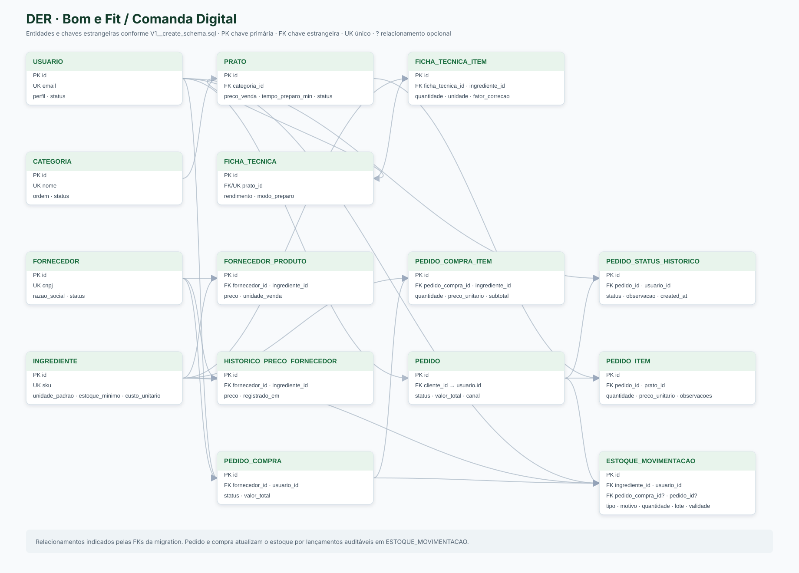

# Bom e Fit · Comanda Digital

Aplicação acadêmica de comanda digital para dark kitchen, guiada pelo SRS Comanda Digital v3.2. O repositório contém o frontend Angular, API Spring Boot e persistência MySQL.

## URLs do Sistema em Produção (Deploy em Nuvem)

- **API REST (Render):** `https://comanda-digital-plko.onrender.com/api`
- **Health Check:** `https://comanda-digital-plko.onrender.com/api/health`
- **Swagger / OpenAPI:** `https://comanda-digital-plko.onrender.com/swagger-ui.html`
- **Banco de Dados (Railway):** MySQL 8.4 gerenciado com migrations Flyway (V1, V2, V3)
- **Frontend (Cloudflare Pages):** `https://comanda-digital.pages.dev`

## Stack

- Angular 22.2, TypeScript, Router, HttpClient, Chart.js 4 carregado sob demanda no dashboard.
- Java 17, Spring Boot 3.5, Spring Security/JWT, Spring Data JPA, Bean Validation.
- MySQL 8.4, Flyway e Swagger/OpenAPI em `/swagger-ui.html`.

## Rodar com Docker Compose

Requer Docker Engine/Desktop com Compose.

1. Copie `.env.example` para `.env`, troque as senhas e gere `JWT_SECRET` com `node -e "console.log(require('crypto').randomBytes(32).toString('base64'))"`.
2. Execute `docker compose up --build` na raiz.
3. Acesse o frontend em `http://localhost:4200`; API em `http://localhost:8080/api`; Swagger em `http://localhost:8080/swagger-ui.html`.

O Compose inicia MySQL e aguarda o health check antes da API. Flyway cria o schema e os dados iniciais. O MySQL persiste no volume `mysql_data`; `docker compose down -v` remove o volume e seus dados.

## Desenvolvimento local fora dos containers

Requer Node.js 24, Java 17 e MySQL 8.4. O Maven Wrapper do backend baixa a versão fixada do Maven na primeira execução.

1. Inicie MySQL (`docker compose up -d mysql`) ou uma instância compatível.
2. Configure no processo Java `DB_URL`, `DB_USERNAME`, `DB_PASSWORD`, `JWT_SECRET` e `FRONTEND_URL`. O Spring não lê `.env` automaticamente.
3. Na pasta `backend`, execute `./mvnw spring-boot:run` (Linux/macOS) ou `./mvnw.cmd spring-boot:run` (Windows).
4. Na raiz, execute `npm ci` e `npm start`.

O segredo JWT deve ser Base64 com pelo menos 32 bytes. O valor em `.env.example` é um marcador inválido até ser substituído. `.env` é ignorado pelo Git.

Para rodar a suite completa de testes automatizados (19 testes unitários cobrindo as regras de negócio RN01 a RN10):
```bash
# Na pasta backend
./mvnw test       # Linux/macOS
.\mvnw.cmd test   # Windows
```

Para empacotar sem executar testes, use `./mvnw -DskipTests package` (ou `./mvnw.cmd -DskipTests package` no Windows).

## Roteiro do Vídeo Pitch

Consulte [docs/ROTEIRO_VIDEO_PITCH.md](docs/ROTEIRO_VIDEO_PITCH.md) para o roteiro oficial de 5 minutos, estruturado de acordo com a Seção 9.3 do SRS (3m30s de demonstração funcional + 1m30s de arquitetura e deploy).

## Demonstração local

- Login seed: `admin@email.com` / `senha123`.
- Seed: categorias, ingredientes, seis pratos/fichas e saldos iniciais.
- Troque/remova a senha de demonstração antes de expor a aplicação publicamente.

## Funcionalidades implementadas no código

Cardápio e detalhes públicos, carrinho com observações, cadastro/login, checkout simulado, acompanhamento e histórico de pedidos; RBAC com quatro perfis; administração de cardápio e fichas técnicas com custo/food cost; pedidos e cozinha com transições, paginação e filtros; estoque e movimentações; fornecedores, catálogo, cotação e histórico de preços; compras com vários itens; dashboard com indicadores e gráficos.

Consulte [PROJECT_CONTEXT.md](PROJECT_CONTEXT.md) para o mapeamento requisito a requisito, decisões e limitações de validação. Frontend e API já compilaram; a API passou por smoke check com MySQL local descartável. Compose/containers e deploy público ainda não foram validados. O bundle inicial Angular tem 439,81 kB; Chart.js fica em chunk carregado sob demanda.

## Modelo de dados



Fonte editável do diagrama: [Mermaid](docs/DER_Comanda_Digital.mmd). O DER representa as entidades e chaves estrangeiras definidas na migration inicial.

## Estrutura

- `src/`: aplicação Angular.
- `backend/src/main/java`: controllers, services, repositories, entities e DTOs.
- `backend/src/main/resources/db/migration`: schema e seed Flyway.
- `compose.yaml`, `Dockerfile`, `backend/Dockerfile`, `deploy/`: imagens e configuração Nginx.
- `PROJECT_CONTEXT.md`: contexto detalhado e próximos passos.

Não há URL pública de produção ainda; não publique links até realizar e validar o deploy.
